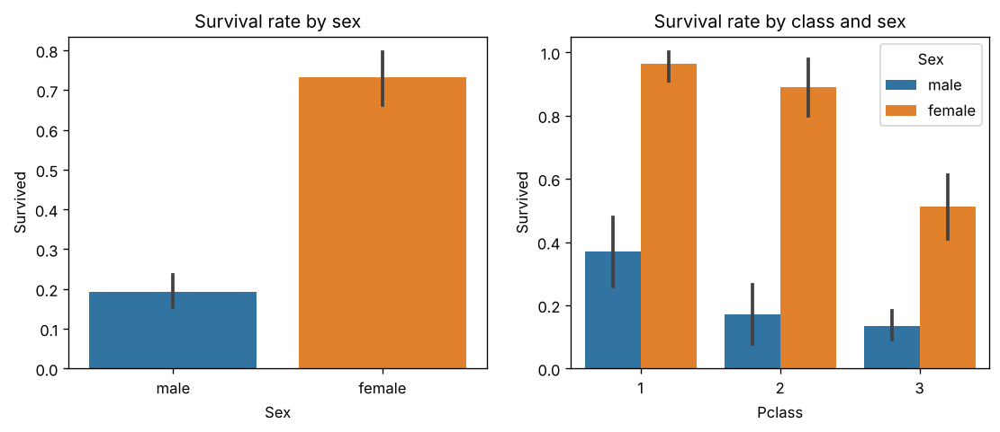
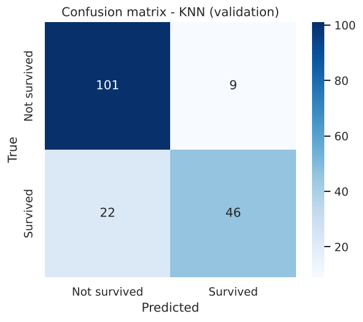
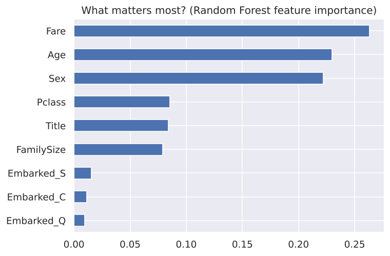

# 🚢 Titanic Survival Prediction: End-to-End ML Project

An end-to-end supervised classification project that predicts whether a Titanic passenger survived. It is built around a reusable, leakage-free scikit-learn **Pipeline** with custom transformers, a fair model comparison, hyperparameter tuning, and a single final evaluation on an untouched test set.

## 📌 Overview
| | |
|---|---|
| **Dataset** | 891 passengers, 12 columns ([Kaggle Titanic](https://www.kaggle.com/competitions/titanic)) |
| **Task** | Binary classification (survived / did not survive) |
| **Tools** | Python, pandas, NumPy, scikit-learn, Matplotlib, Seaborn, joblib |
| **Final result** | **84.9% accuracy** on the held-out test set (152 / 179) |

## 🔍 Workflow
1. **Inspect the data:** 38.4% survival rate; missing values in `Age` (177), `Cabin` (687), and `Embarked` (2).
2. **Split once, up front:** stratified 60 / 20 / 20 train, validation, and test split (534 / 178 / 179 rows), so the test set is never touched until the end.
3. **Explore:** survival by sex, class, age, and fare; distributions and correlations.
4. **Build the preprocessing pipeline:** 11 steps made of custom transformers, each doing one job: type conversion, imputation of `Age` and `Embarked`, feature engineering, dropping unused columns, one-hot and label encoding, and scaling. It is fitted on training data only, which prevents data leakage.
5. **Engineer features:** `Title` extracted from the passenger name and `FamilySize` from `SibSp` + `Parch`.
6. **Compare models** against a 61.6% majority-class baseline.
7. **Tune** the best model with `GridSearchCV` and `RandomizedSearchCV` (5-fold CV).
8. **Evaluate once** on the test set and save the final pipeline with joblib.

## 📊 Results

**Model comparison (validation set)**

| Model | Train accuracy | Validation accuracy |
|---|---|---|
| Logistic Regression | 79.6% | 80.9% |
| **KNN** | 83.9% | **82.6%** |
| Decision Tree | 97.9% | 76.4% |
| Random Forest | 97.9% | 77.5% |

The tree models score ~98% on training data but much lower on validation: a clear sign of overfitting, which is why KNN was selected.

**Final model (tuned KNN: k = 15, Manhattan distance)**

| Stage | Accuracy |
|---|---|
| Majority-class baseline | 61.6% |
| Validation | 83.1% |
| **Test (data never seen before)** | **84.9%** |

**Most important features** (Random Forest importance): Fare, Age, Sex, Pclass, Title.

<p align="center">
  
  
</p>
<p align="center">
  
</p>

## ▶️ How to Run
The whole project is in **one file**: `titanic_all_in_one.py`.
```bash
pip install -r requirements.txt
python titanic_all_in_one.py
```
It trains, tunes, and evaluates the model, saves the charts and the model, then predicts a few example passengers (~15 seconds).

Predict your own passenger:
```bash
python titanic_all_in_one.py --name "Smith, Mrs. Anna" --sex female --pclass 1 --age 30 --fare 80
```
Add `--show` to also open each chart in a window.

## 📁 Project Structure
```
├── titanic_all_in_one.py      # The full project: pipeline, modeling, prediction
├── requirements.txt
├── data/train.csv             # Dataset
└── outputs/
    ├── figures/               # Charts
    ├── models/                # Saved pipeline (.joblib)
    └── results.json           # All metrics from the last run
```

## 👤 Author
**Waseem Mahmoud** · [LinkedIn](https://www.linkedin.com/in/waseem-mahmoud-a34154213) · [GitHub](https://github.com/waseemalali)
